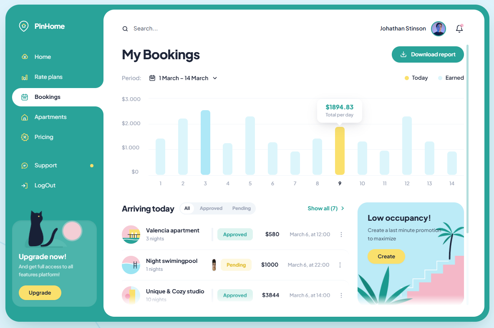

# PinHome — My Bookings Dashboard



Dashboard template untuk manajemen properti sewa jangka pendek (short-term rental): bookings, rate plans, apartments, smart pricing, dan support — semuanya dalam satu halaman.

> Template frontend murni (HTML + CSS + JS). Semua data adalah data demo di `assets/js/config.js`. Siap dipakai banyak orang: ganti identitas host & data melalui satu file konfigurasi.

## Struktur Folder

```
pinhome_my_bookings_dashboard/
├── index.html              # Entry point (markup semua view & modal)
├── image.png               # Preview screenshot
├── assets/
│   ├── css/
│   │   └── style.css       # Design system & komponen kustom (non-Tailwind)
│   ├── js/
│   │   ├── config.js       # Semua data demo + konfigurasi identitas host
│   │   └── dashboard.js    # Logika aplikasi (navigasi, chart, render, modal)
│   └── img/                # Folder aset gambar (kosong, siap diisi)
├── LICENSE
└── README.md
```

## Menjalankan

Tidak perlu build. Buka langsung:

1. **Langsung**: buka `index.html` di browser (double-click), atau
2. **Lewat server lokal** (disarankan):

   ```bash
   # Python
   python -m http.server 8000

   # atau Node.js
   npx serve .
   ```

   Lalu buka `http://localhost:8000`.

## Menggunakan Template (Multi-User)

Semua data demo dan identitas host berada di **satu file**: `assets/js/config.js`.

1. Buka `assets/js/config.js`.
2. Ubah `APP_CONFIG` (nama host, avatar, dll).
3. Ganti `bookingsData`, `apartmentsPortfolio`, `ratePlansData`, dst. dengan data Anda.
4. Deploy ke GitHub Pages / Netlify / Vercel — static hosting apa pun.

## Fitur

- **Bookings**: chart pendapatan 14 hari interaktif, filter status (All/Approved/Pending), daftar tamu datang, toggle status booking.
- **Home**: KPI cards, housekeeping & room turnovers, channel revenue share, smart home monitor.
- **Rate Plans**: paket musiman + matriks tarif 7 hari interaktif (surge +15%).
- **Apartments**: 8 kartu properti dengan filter status & occupancy bar.
- **Pricing**: simulator yield dinamis (base rate, surge, diskon) + automation rules.
- **Support**: FAQ accordion, live chat concierge (demo), dokumen host.
- Navigasi sidebar dengan pill animasi, pencarian kontekstual per halaman, notifikasi, toast, dan responsif mobile.

## Teknologi

- [Tailwind CSS (CDN)](https://tailwindcss.com/) — utility styling
- [Plus Jakarta Sans](https://fonts.google.com/specimen/Plus+Jakarta+Sans) — tipografi
- Vanilla JavaScript — tanpa framework, tanpa build step

## Lisensi

MIT — lihat [LICENSE](LICENSE).
